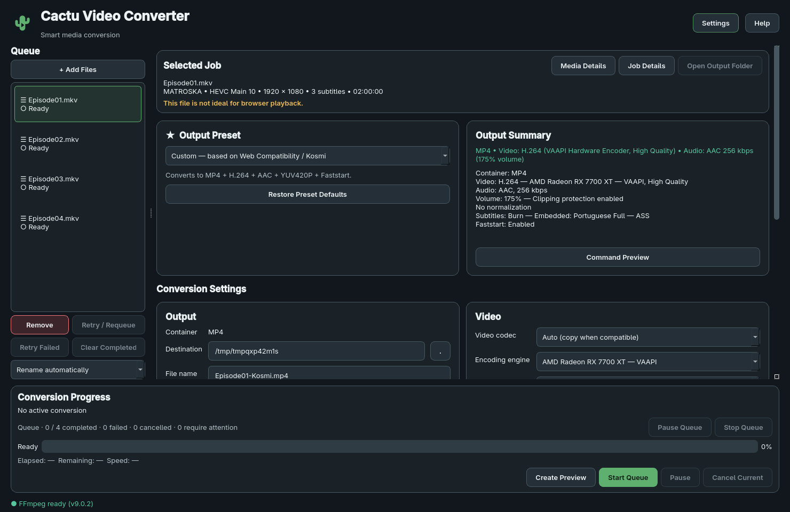

# Cactu Video Converter

A desktop video transcoder for Windows and Linux, powered by FFmpeg. Convert local
videos with compatibility presets, per-file settings and a sequential queue.
Normal conversion is offline. There is no telemetry or automatic upload of media,
diagnostics or logs.



## Download

Use the [official GitHub Releases](https://github.com/drrrrigo/cactu-video-converter/releases).
The first target is **v0.1.0-beta.1 — Public Beta**. Only packages attached to an
approved pre-release are public downloads; build candidates are not approved releases.
If no pre-release is listed, beta hardening is still in progress.

| Platform | Download |
| --- | --- |
| Windows 11 x86_64 — recommended | `CactuVideoConverter-Setup-0.1.0-beta.1.exe` |
| Windows 11 x86_64 — portable | `CactuVideoConverter-Portable-0.1.0-beta.1.zip` |
| Linux x86_64 | `CactuVideoConverter-0.1.0-beta.1-x86_64.AppImage` |
| Verification | `SHA256SUMS.txt` |

Published packages include Python, Qt/PySide6, FFmpeg and FFprobe. You do not need to
install Python, pip or system FFmpeg. macOS, ARM and Windows ARM are unsupported.
See [installation](docs/INSTALLATION.md) and [known beta limitations](KNOWN_ISSUES.md).

## Features

- Web Compatibility / Kosmi preset: MP4, H.264, AAC, yuv420p and Faststart.
- Independent queue jobs, multi-file drag/drop, bulk presets and semantic track matching.
- Smart stream copy, software x264, optional NVENC/AMF/VAAPI/Quick Sync encoding.
- Audio-track selection, 0–300% volume, clipping protection and measured loudness normalization.
- Embedded/external ASS, SSA and SRT text subtitle burn-in; selectable subtitle support.
- Quick Preview, progress/ETA, pause/resume, cancel current, pause-after-current and retry.
- Local logs and sanitized diagnostic copying for bug reports.

Kosmi is an independent compatibility preset; this project is not affiliated with
that service. Keep your original media files, especially while testing a beta.
Cactu validates output before finalizing it and does not intentionally delete inputs.

## Installation

**Windows:** download the Setup executable, review the source/checksum, then follow
the per-user installer. Or extract the complete Portable ZIP and run
`CactuVideoConverter.exe`. Do not move that executable out of its supporting folder.
Beta signing status is stated in the release notes; unsigned builds can trigger
reputation warnings. Do not disable Microsoft Defender or SmartScreen globally.

**Linux:** download the AppImage, enable “Allow executing as a program” in your file
manager's Properties/Permissions, then launch it. A terminal alternative is:

```bash
chmod +x CactuVideoConverter-0.1.0-beta.1-x86_64.AppImage
./CactuVideoConverter-0.1.0-beta.1-x86_64.AppImage
```

A compatible Linux desktop/graphics stack is still required. See the installation
guide for the build baseline, extraction mode and verification instructions.

## Hardware acceleration

Software x264 is the default and remains available without a functioning GPU encoder.
Drivers are supplied by your OS/vendor. **Settings → Hardware Acceleration** explains
GPU, backend, driver and render-device evidence and links to official guidance.
**Test Again** refreshes availability after system changes. Cactu never installs
GPU drivers or runs package-manager/privileged commands. Explicit encoder choices
are not silently changed. [Hardware Assistant guide](docs/HARDWARE_ASSISTANT.md).

## Reporting bugs

Use [GitHub Issues](https://github.com/drrrrigo/cactu-video-converter/issues) for
crashes, conversion/subtitle/audio/queue failures, packaging, hardware or UI scaling
problems. Include the beta version, OS, installation type, encoder and reproduction
steps. **Settings → Diagnostics → Copy Diagnostics** produces a sanitized local
report for review and manual pasting. Raw logs can contain media paths: review
before sharing. Prefer synthetic reproduction files and metadata; do not upload
private or copyrighted media without permission. No report is sent automatically.
Report vulnerabilities privately as described in [SECURITY.md](SECURITY.md).

## Building from source

Development instructions are in [BUILDING](docs/BUILDING.md),
[CONTRIBUTING](CONTRIBUTING.md) and the [release plan](docs/PUBLIC_BETA_RELEASE_PLAN.md).
Source execution uses an explicit development FFmpeg flag; it is not the normal
end-user installation method. Public packages are produced by native CI jobs and
must pass packaged conversion, licensing and exact-candidate review gates.

## Licensing and third-party components

Cactu's original source code is **GPL-3.0-or-later**, selected by the project owner;
see [LICENSE](LICENSE). FFmpeg, Qt/PySide6, Python and other components retain their
own licenses. See [THIRD_PARTY_NOTICES](THIRD_PARTY_NOTICES.md) and the
[release license audit](docs/RELEASE_LICENSE_AUDIT.md). An unfinished dependency/
corresponding-source audit blocks binary publication. GPL source availability does
not by itself certify a particular binary bundle for redistribution.
