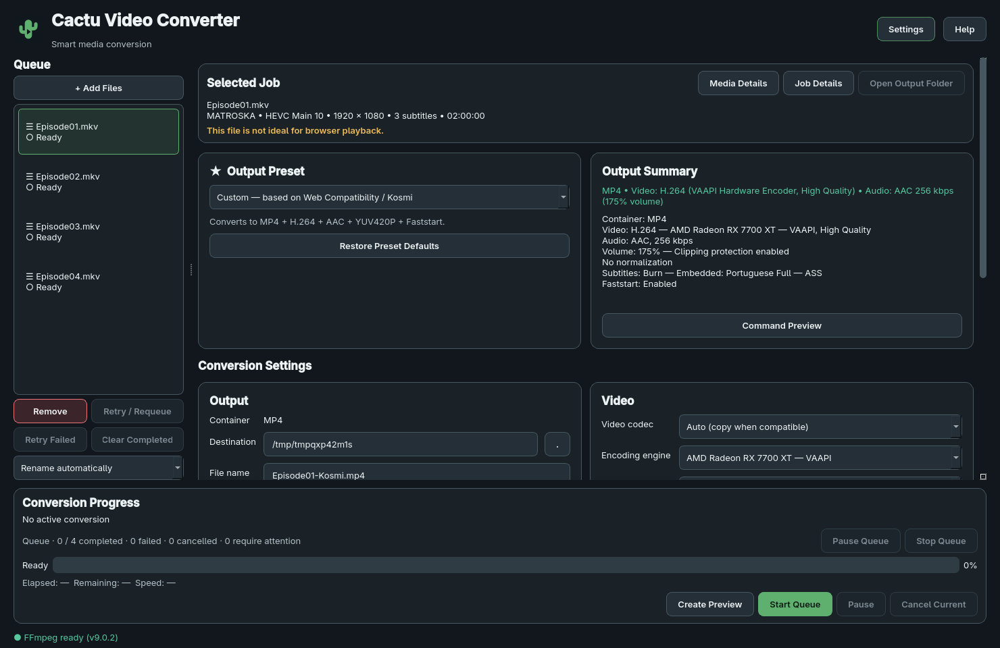

# Batch conversion and queue

Every input is a job, including a single video. There is no separate Batch Mode.
The left sidebar lists jobs, the main area edits the selected job, and the
bottom area shows the active conversion and queue controls.

## Add and configure

Use **+ Add Files**, a native multi-file dialog, or drop files into the window
or queue. Extensions are only a dialog convenience: every candidate must be a
readable regular file and FFprobe must recognize a video stream. Bad candidates
remain visible as **Requires attention** without preventing valid files from
running. Remove and add an invalid input again after repairing it to re-probe.

Analysis is asynchronous, limited to **two FFprobe processes**. Callbacks carry
UUID job IDs; removal or selection changes cannot attach results to another
input. An earlier job still being analyzed holds its execution position, even
when a later probe finishes first. Adding files while running is supported;
new jobs append, analyze and wait without disturbing the active job.

The same resolved path is added once per queue session. Relative/symlink aliases
resolving to that path are duplicates. Same filenames in different directories
remain distinct. Duplicate feedback appears in the footer.

Click a row to configure its independent settings. Ctrl/Cmd and Shift use Qt's
extended selection. Loading a different job uses a guard to prevent interim
widget values being written into another job. Media Details uses cached
MediaInfo: format, duration, size, video/audio/subtitle fields, attachments and
format metadata. It does not probe again just to show details.

Pending jobs remain editable while another runs. Active jobs, including GPU
checks, loudness analysis and verification, are locked. Terminal jobs stay
inspectable; **Retry / Requeue** explicitly unlocks them for another conversion.
Changing settings never changes an existing output. Job Details retains exact
execution snapshots and per-attempt diagnostics. Open Output Folder opens the
last verified output's folder.

## Bulk actions

Multiple selection reveals a contextual action bar above the settings:

- **Apply Web Preset** gives each editable selected job independent Web/Kosmi
  settings and a media-specific plan, retaining its own output identity. H.264
  may copy while HEVC/AV1 require encoding.
- **Copy from** explicitly identifies the source job. It initially retains the
  last single selected job when selection expands. Moving the highlighted row
  does not change this source. Choose a different source in the dropdown when
  needed, then **Copy Settings** to the other selected editable jobs. A source
  outside the destination selection can also be chosen.
- **Output Folder** changes directories for editable selected jobs while keeping
  separate filenames. Start Queue resolves collisions before dispatch.

Active/terminal jobs are excluded from bulk mutations. Requeue terminal jobs
before editing. Remove/Clear Completed do not delete source or output movies;
only generated preview files for removed jobs are cleaned up.

### Semantic stream matching

Bulk copying never transfers raw global indexes/ordinals. The destination's
own streams are searched using normalized language aliases and Unicode/title
text. A generic language may match a regional form; known conflicting languages
or regions are rejected.

Audio ranks language + title, language, then title, with channels/layout and
codec context to break ties. Equal best matches remain ambiguous. There is no
silent default-track fallback for missing identified intent.

Subtitles rank language + title, title, then language, with codec/default context.
Forced disposition must agree. Known different titles, such as Full and Signs
& Songs, are rejected. Missing metadata can require explicit selection rather
than guessing. Unresolved fields produce warnings and block that job. Select
the affected track explicitly, or disable subtitles if appropriate, to clear
the issue. Changing an unrelated setting does not clear it.

Concrete **external subtitle paths are never copied**. Burn mode can transfer,
but each destination needs its own subtitle file or embedded track. Automatic
external-subtitle filename pairing is not implemented.

## Outputs and validation

Choose the sidebar policy before Start Queue:

| Policy | Behavior |
| --- | --- |
| Rename automatically (default) | Reserve unique names in displayed order, appending `-2`, `-3`, etc. when necessary. |
| Skip existing | Existing destinations are skipped with Requires attention; duplicate pending destinations are flagged. |
| Require attention | Existing destinations and all pending jobs sharing a path are blocked until resolved. |

No policy authorizes overwrite. Preflight checks input/output identity, other
queue inputs, destination directories, settings, subtitle sources, loudness
and cached hardware capability through the existing validator/planner. Valid
pending output names are reserved up front. New/edited jobs are rechecked
before dispatch; a file appearing after a job starts still fails the runner's
final replacement check safely.

If some jobs are invalid, Start Queue shows ready/attention counts and allows
valid jobs to proceed. Invalid jobs remain for review. There are no per-file
overwrite or success prompts. If an earlier input is still analyzing, execution
waits for its result.

## Order, concurrency and controls

**Exactly one conversion job runs at a time.** Drag pending/analyzing rows to
reorder them; displayed order is execution order. Active rows cannot be moved
or removed, and moves changing the active row's position are rejected. Terminal
rows are not draggable. Other pending rows may be reordered while running.

| Action | Meaning |
| --- | --- |
| Pause / Resume | Suspend/resume the current FFmpeg analysis or encode process. |
| Pause Queue | Finish the current file, then wait. Shows “Queue will pause after current file”. |
| Resume Queue | Continue pending jobs, or cancel an outstanding pause-after-current request. |
| Cancel Current | Cancel/clean the active job, mark Cancelled and continue unless pause/stop was requested. |
| Stop Queue | Confirm cancellation of the current job; leave remaining jobs pending and start no more. |
| Retry Failed | Revalidate failed jobs once; click Start Queue to run valid ones. |
| Retry / Requeue | Return selected failed/cancelled/completed jobs to editing/validation. |
| Clear Completed | Remove completed rows while retaining converted files. |

GPU-check cancellation waits for that short worker to exit, preventing its
result from launching a cancelled encode. The next job waits for its shutdown.
Failure belongs to one job: preserve its error/logs, clean resources, continue.
No retry loop or silent software fallback is used. Requeue and explicitly choose
Software if the selected hardware becomes unavailable.

Completed means conversion, FFprobe verification, atomic finalization and cleanup
all succeeded. The next dispatch follows the runner's terminal signal on a later
event-loop turn. Current-job progress/ETA/speed reuse the existing parser, with
separate loudness/encoding stages. Queue progress is a job count, not a fabricated
weighted percentage or total ETA. Completion produces one inline count summary.

## Preview, audio and hardware

Create Preview uses the selected job and its own managed PreviewStore. It never
requeues the job or changes queue status/order. Each job retains its latest
successful preview across failed/cancelled attempts. Preview is disabled while
the queue is running, paused or stopping; selection/configuration is locked
during preview creation to protect its snapshot.

The existing runner handles smart copy, x264/GPU video, embedded/external
subtitles, manual volume/clipping and loudness. Cache keys include source
path/stat/stream/targets/runtime, preventing cross-input measurement reuse.
Each job retains its own reports; preview diagnostics stay separate from full
conversion history. Full-track normalized preview analysis is unchanged.

Hardware choice can be copied as scalar intent, but each required GPU gets a
fresh asynchronous initialization check before that job starts. A failed check
marks only that job Failed. No batch command builder or batch FFmpeg runner exists.

## Architecture and states

`models/job.py`: ConversionJob, explicit JobStatus/ValidationState, JobAttempt
and diagnostics. IDs are UUIDs, settings/plans are frozen values, and attempt
records retain exact snapshots, timestamps, errors and logs. There are no live
Qt/process/temporary-directory objects in domain state.

`models/queue.py` owns order, duplicate identity, counts and queue state.
`services/queue_controller.py` orchestrates validation, preflight, dispatch,
controls, retry and terminal transitions. `services/probe_pool.py` owns import
processes. `services/batch_settings.py` copies scalar intent and matches streams.
`ui/queue_view.py` separates stable-ID internal move MIME from external URL MIME.
`ui/queue_panel.py` binds selections/bulk actions; MainWindow retains configuration
panels and the existing per-job preview launch path.

Jobs: Analyzing → Ready/Invalid → Waiting → Running/Paused/Finalizing →
Completed/Failed/Cancelled; Retry/Requeue returns terminal jobs to validation.
Queue: Idle → Running → Completed; Pause Requested → Paused → Running for
pause-after-current; Stopping → Idle for Stop. Process pause is independent.

## Persistence and limits

QSettings stores geometry, splitter sizes, last Add Files and bulk output
directories. Queue contents/history, loudness measurements and previews are
**session-only**. Closing removes generated previews where possible; crashes
and file locks can leave temporary folders. No crash recovery/database exists.
Structured records permit future explicit serialization without pickling Qt.

Concurrent conversion, recursive folder import, external subtitle pairing,
automatic retry/fallback, total queue ETA, stop-on-error and notifications are
not implemented. Native Windows queue/drag execution, very large queues,
full-length movies and physical GPUs beyond tested AMD VAAPI remain verification
work. Existing bundled-release/provenance gates remain open. Future concurrency
should extend controller/executor resource ownership and retain the single-plan
media pipeline as an explicit new milestone.
