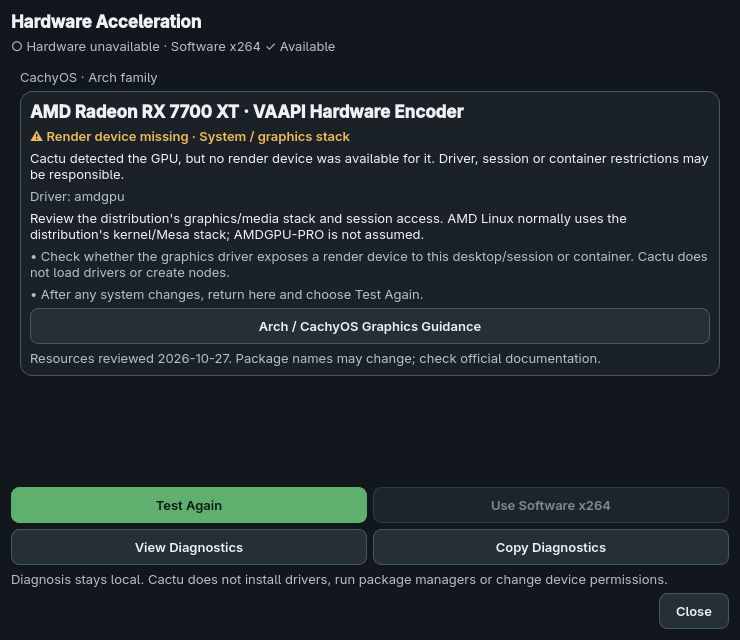

# Hardware Acceleration Assistant

## Using the assistant

Open **Settings → Hardware Acceleration** at any time. **Hardware Details** is
an alias that opens its technical section. If a potentially supported GPU is
visible but no backend works, a nonmodal banner offers **Fix Hardware Acceleration**
and **Dismiss**. A missing GPU is a valid software-only configuration, not a scary
startup error. A working backend suppresses the global warning, even when a second
GPU/backend fails or the user intentionally chooses Software x264.

The assistant shows overall hardware/software status, GPU/backend findings, driver
evidence, a plain explanation, recommended next steps and official support links.
Available backends do not show unnecessary driver remediation. Technical details
are optional. **Copy Diagnostics** copies a bounded sanitized local report; it
never uploads a report or opens an issue automatically.

**Test Again** refreshes OS inventory, dynamic render-node discovery and FFmpeg
initialization probes, updates the encoding dropdown and revalidates pending jobs.
No restart is normally needed. It is disabled during conversion, preview, paused/
stopping queues and an existing hardware test. Opening the page uses cached results
and does not run another test. **Use Software x264** explicitly changes the selected
editable job; it is disabled without such a job and cannot mutate an active plan.

[Available state](assets/hardware-assistant-available.png) ·
[Packaging error](assets/hardware-assistant-packaging.png) ·
[Mixed GPUs](assets/hardware-assistant-multiple.png) ·
[Banner](assets/hardware-banner.png) ·
[Details](assets/hardware-assistant-details.png)

Screenshots are Qt renders of synthetic evidence, including simulated Windows
findings. They are not native Windows/GPU test results.

## Evidence and architecture

The existing `HardwareEncoderDetector` remains authoritative. It lists FFmpeg
encoders and runs the existing short encoding pipeline for each applicable device,
all three quality profiles, subtitle filtering and 10-bit input. Detecting a GPU,
listing an encoder or seeing a render node is insufficient for availability.

The startup/re-test `HardwareDetectionWorker` runs this work asynchronously, then
adds read-only OS inventory, FFmpeg filter/hardware-API inspection and structured
interpretation. It does not repeat the actual encoder probes to create an explanation.
The selected-conversion/queue preflight remains fresh and separate. Models in
`models/hardware_diagnosis.py` are frozen typed records; `hardware/inventory.py`,
`diagnosis.py`, `resources.py` and `report.py` have no Qt widget responsibilities.
`ui/hardware_assistant.py` presents the result; the small panel mixin binds actions
and banner state. No conversion commands, quality profiles or media filters changed.

### Windows

Read-only `EnumDisplayDevicesW` enumeration supplies adapter model, status and
structured PCI vendor/device identity. Adapter registry values supply driver name/
version when readable. Vendor IDs take priority over arbitrary display strings.
No PowerShell, WMIC, vendor utility or package manager is required. Driver absence
is not inferred merely because the registry lacks a version. There is no arbitrary
minimum-driver database: a driver/API incompatibility is claimed only when the
actual probe explicitly reports it.

| GPU vendor | Expected Windows backend |
| --- | --- |
| NVIDIA | NVENC / `h264_nvenc` |
| AMD | AMF / `h264_amf` |
| Intel GPU | Quick Sync / `h264_qsv` |

An Intel CPU is not evidence of an Intel GPU. Notebook/OEM driver policy is left to
the user. The current encoding adapters use default-device probes on Windows and
for NVENC. Several same-vendor GPUs therefore produce an adapter-attribution warning;
a successful default-device probe establishes overall availability without claiming
each adapter works. Session enumeration may omit headless/compute-only adapters.
Native Windows execution remains to be verified.

### Linux

PCI display-controller entries and DRM device links provide vendor/device IDs,
bound drivers and exact render-node association. Every visible `renderD*` node is
considered, with existence/access/mode evidence. `/dev/dri/renderD128` is never
assumed. GPU names use a kernel label or an optional existing local `pci.ids` file;
otherwise the UI shows the vendor and numeric PCI IDs. A database label may identify
a chip family shared by several retail cards; it does not establish a unique model.
No ID database is downloaded or required.

`/etc/os-release` is parsed as data, never sourced/executed. ID/ID_LIKE identify
Arch (including CachyOS), Debian (including Ubuntu), Fedora/RHEL and SUSE families.
Unknown distributions get a generic explanation and a relevant official vendor
resource when available, with no guessed package names/commands.

AMD uses the existing VAAPI strategy. NVIDIA expects NVENC. Intel retains the
existing QSV and VAAPI choices; this feature introduces no new backend preference.
A missing node can reflect a driver, graphics-stack, container or session issue;
permission denial can reflect device ACLs/groups or session restrictions. Cactu
reports evidence without changing permissions or assuming one group remedy fits
all distributions. A missing bound driver is reported only when observed reliably.

## Failure categories and responsibility

| Category | Interpretation / next step |
| --- | --- |
| AVAILABLE | The actual encoder probe passed; no driver remedy needed. |
| NO_SUPPORTED_GPU | No supported encoder was detected; x264 is supported. |
| FFMPEG_ENCODER_MISSING | Required encoder is absent from the runtime; changing drivers cannot add it. |
| APPLICATION_PACKAGING_ERROR | A required FFmpeg filter/hardware API is missing. |
| DEVICE_NODE_MISSING | No associated render device is visible; review graphics/session/container state. |
| DEVICE_PERMISSION_DENIED | Access evidence or the probe reports denial; review session/device policy. |
| DRIVER_NOT_DETECTED | No bound graphics driver was observed; not inferred from every failed probe. |
| DRIVER_TOO_OLD_OR_INCOMPATIBLE | A probe explicitly reported a driver/API incompatibility. |
| GPU_DETECTED_ENCODER_UNSUPPORTED | The probe reports no supported encoding capability for this backend. |
| MISSING_SYSTEM_COMPONENT | A required graphics/media runtime library could not be loaded. |
| BACKEND_INITIALIZATION_FAILED | Initialization failed; the root cause remains unproven. |
| BACKEND_DEVICE_MISMATCH | Probe/node evidence does not match this GPU. |
| MULTIPLE_GPU_AMBIGUITY | A default-device probe cannot be assigned to one of several matching adapters. |
| UNKNOWN | Evidence is incomplete; inspect details and re-test rather than inventing a cause. |

Actual successful initialization takes precedence over incomplete supplemental
metadata. Failure signatures are conservative explanations, not an exhaustive GPU
support database. Missing FFmpeg capabilities are application/build issues for a
bundled runtime, or explicitly **Development FFmpeg runtime** issues in development.
Those findings offer build/diagnostics guidance and no driver-download controls.

No-hardware configurations are informational; detected but unavailable GPU pipelines
are warnings; missing expected build capabilities are errors. Text/icons accompany
colors. One working backend means overall hardware is available on mixed-GPU systems.

## Official guides and command policy

`hardware/resources.py` centralizes immutable support resources with vendor/platform,
label, description, HTTPS URL and review date. Only registered resources on exact
approved hosts can be opened through Qt's safe URL API. UI/system strings cannot
supply arbitrary URLs. Browser-launch failure is handled locally; Cactu does not
fetch pages to check their content or send hardware details to them. A remote 404,
redirect or access challenge must be resolved in the browser or by a registry update.

Windows guidance links to [AMD support](https://www.amd.com/en/support),
[NVIDIA drivers](https://www.nvidia.com/en-us/drivers/) and
[Intel support](https://www.intel.com/content/www/us/en/support/detect.html).
Linux guides link to [Arch video acceleration](https://wiki.archlinux.org/title/Hardware_video_acceleration),
[Debian video acceleration](https://wiki.debian.org/HardwareVideoAcceleration),
[Ubuntu NVIDIA documentation](https://documentation.ubuntu.com/server/how-to/graphics/install-nvidia-drivers/),
[Fedora documentation](https://docs.fedoraproject.org/en-US/quick-docs/) and
[openSUSE graphics guidance](https://en.opensuse.org/SDB:Configuring_graphics_cards).
The Intel Linux fallback uses the official
[graphics media stack overview](https://www.intel.com/content/www/us/en/developer/topic-technology/open/graphics-media-stack/overview.html).

The built-in family/vendor guide selects issue-specific explanations first and
appropriate documentation second. Fedora/SUSE links are general documentation/setup
entry points, not validated package recipes. Resource locations were reviewed
2026-10-27; several distribution sites blocked automated content retrieval, so no
current package/version recipes are asserted.

**No package-manager commands are shipped in this milestone.** `optional_commands`
is empty for every guide, and there is no command execution/copy-install workflow.
Cactu never runs sudo, apt, pacman, dnf, zypper, installers, chmod, usermod, kernel/
bootloader/repository changes, privileged terminals or password prompts. It does not
download drivers. AMDGPU-PRO is not the default Linux recommendation. Correct
instructions depend on release, GPU generation, session and distribution policy;
official documentation is preferable to an unmaintained generic command.

## Queue, preflight and software behavior

Existing explicit selections are preserved. A failed selected-backend preflight
marks the current attempt failed and revalidates pending jobs against the failed
capability; jobs needing that same encoder become Requires Attention. Other valid
jobs can continue, including smart-copy jobs that do not require hardware encoding.
Fresh Test Again success revalidates the pending job without changing its backend.
Preview preflight offers Fix, explicit Software and Cancel actions.

There is no Auto Prefer Hardware mode in the current application; this feature does
not invent one or silently change explicit selections. Software x264 remains the
default and uses the existing planner/runner. Assistant/inventory failures cannot
remove successful probe results or block ordinary software plans. Starting full
conversion/preview from the UI waits until an active hardware test ends to avoid
probing/reconfiguring underneath a new conversion.

## Cache, dismissal and privacy

Detection/diagnosis are cached per application session. Test Again refreshes devices
and probes; opening the assistant only displays cached evidence. Dismissal persists
only a SHA-256 identity derived from app major version, OS/kernel, GPU/driver/device
resources, runtime and failure categories. Changed identity or manual re-detection
reconsiders the warning; recovery clears it. No invasive hardware/driver monitoring
is added. Missing Linux driver-version metadata is supplemented by kernel identity.

All diagnosis is local. There is no telemetry, issue upload or background network
request. Clipboard diagnostics contain Cactu/runtime/OS/distro/GPU/driver/backend,
render access, category, probe command/exit status and a bounded error excerpt.
Arbitrary home/absolute media paths, personal media/subtitle filenames, error URLs
and control characters are scrubbed. Useful `/dev/dri` and NVIDIA device paths
remain. Review any report before sharing; a privacy sanitizer is not a guarantee
that arbitrary third-party driver text can never contain a personal identifier.
Only the local clipboard action copies it.

## Validation and limitations

Unit/Qt tests inject Windows adapters/registry responses and Linux PCI/DRM/os-release/
permissions. They cover all failure families, available/mixed/ambiguous devices,
re-test/cache/node refresh, guide selection/URL safety, sanitized clipboard,
banner identity/dismissal, preserved explicit selections and pending-job recovery.
The full media suite includes actual RX 7700 XT VAAPI work; see the
[implementation report](IMPLEMENTATION_REPORT.md) for counts and runtime evidence.
Native Windows, physical NVENC/AMF/Intel QSV and broad laptop/hybrid configurations
remain unverified. Multi-adapter default-device attribution and missing OS metadata
are reported honestly. Release provenance/native packaging gates remain unchanged.

Primary API references: [EnumDisplayDevicesW](https://learn.microsoft.com/en-us/windows/win32/api/winuser/nf-winuser-enumdisplaydevicesw)
and [os-release](https://www.freedesktop.org/software/systemd/man/latest/os-release.html).
