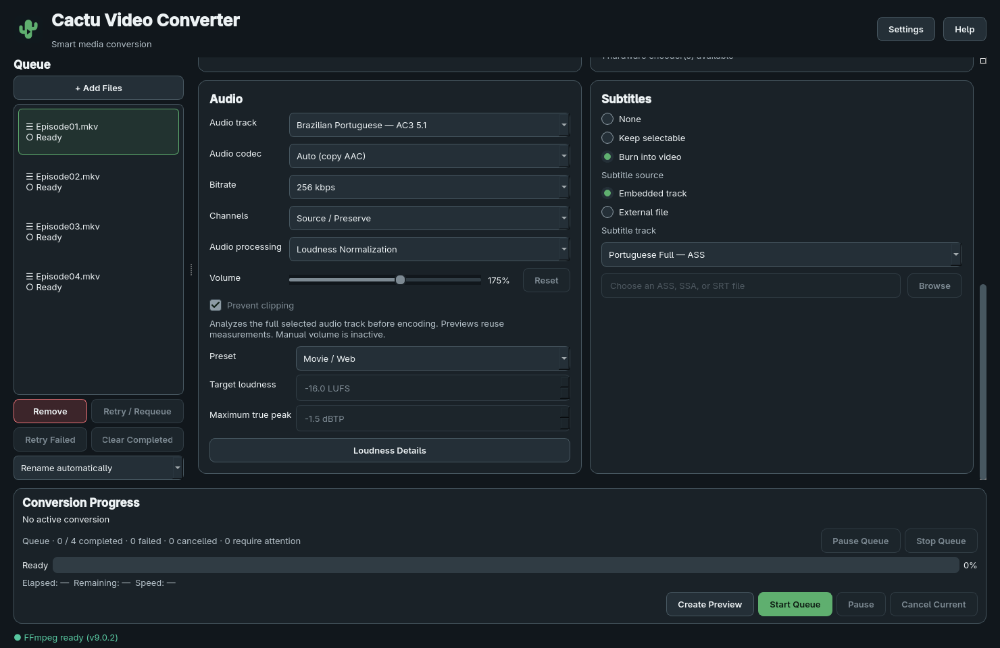

# Loudness normalization

In **Audio → Audio processing**, select **Loudness Normalization**, then a
preset. Start Conversion or Create Preview runs the same measured workflow.
**Loudness Details** shows the targets and the last successful analysis,
including its source, track, cache status and FFmpeg processing mode.

## What the measurements mean

Manual Volume multiplies samples by a percentage. A fixed 200% boost produces
different perceived levels for differently mastered movies. Normalization first
measures the selected soundtrack, then adjusts it toward a chosen listening level.

- **LUFS** expresses measured loudness relative to digital full scale. Less
  negative values are louder. **Integrated loudness (I)** describes the whole
  measured programme rather than one brief peak.
- **Loudness range (LRA)** describes variation over time in loudness units (LU).
  A movie can have quiet dialogue and much louder effects.
- **True peak (TP)** estimates the reconstructed waveform's peaks, including
  peaks between stored samples. dBTP targets below zero leave headroom.

FFmpeg's `loudnorm` implements EBU R128 loudness normalization. The
[EBU R128 recommendation](https://tech.ebu.ch/publications/r128) uses a −23 LUFS
programme target for its broadcast workflow. This application's −16 LUFS
Movie / Web preset is a product choice for comfortable web playback, not a
claim of broadcast compliance or an official Kosmi requirement. Browser/Kosmi
compatibility still concerns the container and codecs.

## Targets

| Preset | Integrated loudness | Maximum true peak | Target LRA |
| --- | --- | --- | --- |
| Movie / Web | −16 LUFS | −1.5 dBTP | 11 LU |
| Louder | −14 LUFS | −1.5 dBTP | 11 LU |
| Conservative | −18 LUFS | −1.5 dBTP | 11 LU |
| Custom | −70…−5 LUFS | −9…0 dBTP | 1…50 LU |

11 LU deliberately leaves more room for film dynamics than FFmpeg's default
7 LU. This target does not force material with a smaller range to expand to
11 LU. Custom exposes LRA as well as I/TP; presets display their fixed I/TP.
The −1.5 dBTP ceiling leaves headroom for reconstruction and lossy encoding.
AAC decoding/resampling can still overshoot the filter's target slightly.

New media and restoring Web Compatibility / Kosmi use **Manual Volume, 100%**.
Normalization is opt-in and marks the output preset Custom. Switching to it
retains the inactive volume slider value; switching back restores that gain.
Its effective manual gain is 100% with manual clipping protection inactive.

## Two passes

1. Analyze the **full selected audio stream**, mapped by its global stream
   index. Video, subtitles and data are excluded from the null output. No video
   frames are decoded or encoded, and no final/partial movie is created yet.
2. Resolve the immutable audio processing plan with measured input I, TP, LRA,
   threshold and target offset. Encode using these values and the targets in
   `loudnorm`, then encode AAC and verify the MP4 before atomic finalization.

The parser locates complete JSON objects among FFmpeg stderr logs. Missing,
malformed, out-of-range and nonfinite measurements are errors. Silent or very
short material can be unmeasurable; the app shows Details and stops before
pass two. It never substitutes a guessed gain or a one-pass movie conversion.

The second pass requests `linear=true`. FFmpeg uses linear scaling when its
measured peak/range constraints permit; it can fall back to **dynamic**
normalization otherwise. Dynamic processing can change dynamics. No separate
compressor, dialogue boost, night mode or manual `alimiter` is added. See the
[official loudnorm documentation](https://ffmpeg.org/ffmpeg-filters.html#loudnorm)
for its linear/dynamic and sample-rate rules.

## Streams, channels and sample rate

Normalization changes samples, so Audio Copy is disallowed and AAC encoding
is required. Compatible H.264/yuv420p video can still be copied. Burning embedded
or external text subtitles forces video encoding independently. x264, NVENC,
AMF, VAAPI and QSV all share this software audio filter path.

Source channels are preserved unless Stereo or 5.1 was requested. Requested
channel conversion happens **before loudnorm in both passes** so the measured
signal matches the final signal. Source AAC-supported sample rates are retained;
unknown/unsupported rates use 48 kHz. An explicit final `aresample` prevents
dynamic loudnorm's internal 192 kHz processing rate from becoming the AAC rate.
No extra audio time shift is introduced by the application.

## Preview and session cache

The first normalized preview can take longer: analysis reads the whole selected
soundtrack even for a short sample far into the movie. It has no preview `-ss`
or `-t`. Subsequent previews and full conversion reuse successful measurements
while the source and processing identity match. Analysis is never replaced by
a segment-only approximation. Dynamic normalization at segment boundaries can
differ from a continuous full-file run; a preview's LUFS need not equal the
programme target because the selected scene may be quiet or loud.

The in-memory LRU cache holds up to 16 analyses. Its key includes resolved source
path, file size and modification time, exact audio stream, requested channel
policy, final sample rate, numeric I/TP/LRA targets, and FFmpeg binary identity
and version. Targets are included because `target_offset` is target dependent.
Source identity is rechecked after analysis and before encoding. No persistent
sidecar files are written. Restarting the application clears the cache.

Analysis and encoding have distinct **Step 1 of 2** / **Step 2 of 2** progress,
elapsed time and ETA. Analysis uses full source duration, encoding uses full or
effective preview duration. A cache hit goes directly to Step 2. Pause/Resume
and Cancel use the existing QProcess/psutil controls in both stages. Cancelling
analysis discards incomplete work and never starts conversion; cancelling pass
two removes its partial output but retains validated measurements.

## Runtime, diagnostics and limitations

Runtime discovery checks `loudnorm` availability. If absent, normalization is
disabled with an explanation while manual conversion remains available.
Explicit normalized requests fail clearly. The release verification script
requires loudnorm alongside AAC/libx264/subtitles. Current validation uses the
local FFmpeg **n9.0.2**, not a completed bundled release. Its exact help and build
configuration are recorded in [runtime evidence](assets/loudnorm-runtime.txt).

Logs record source, selected stream, targets, timing, validated measurements,
cache reuse, commands and second-pass results. Details expose input I/LRA/TP,
threshold, offset and available output statistics. Second-pass statistics are
filter diagnostics before AAC; they are not an independent measurement of the
decoded final file. A silent preview may have no finite result diagnostics.

Synthetic tests measure decoded output independently, including six channel
identity and timestamp checks. They do not establish mastering accuracy for
every movie. Full-length movie performance, native Windows execution, other
physical GPUs, embedded font fidelity and packaged release runtimes remain
separate verification work. Statistical loudness range is less useful on short
samples; the app's analysis always uses all available programme audio.
